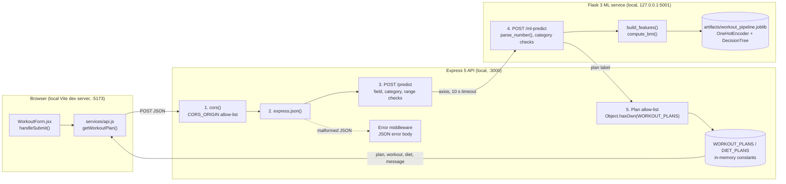
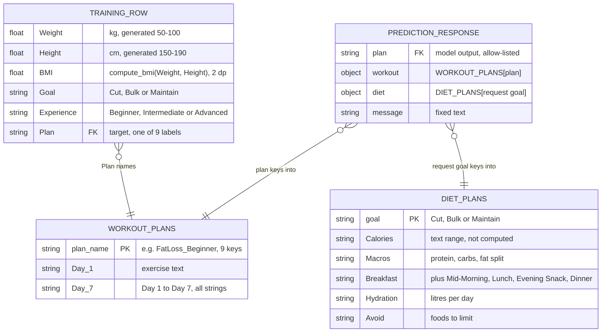

# Workout & Diet Recommendation System — 7-day workout and diet plans from a React, Express and Flask/scikit-learn stack


A user enters weight, height, a fitness goal (Cut, Bulk, Maintain) and an experience level, and gets back a 7-day workout schedule and a diet template. A scikit-learn pipeline served by Flask picks one of nine workout plans. The Express API validates the input, calls the model, and returns the matching hard-coded workout and diet templates. The project is built around **validation at every service boundary**, a **strict contract between model output and templates**, and a **seeded, reproducible train → evaluate → serve pipeline** with documented evaluation. The training data is synthetic and its labels depend only on goal and experience, so weight and height do not change the result. [`ml-service/MODEL_EVALUATION.md`](ml-service/MODEL_EVALUATION.md) measures and documents this.

> **Stack:** React 19 + Vite 8 + Tailwind 4 · Express 5 · Flask 3 + scikit-learn 1.7 — **Core:** ML-selected 7-day workout plan, goal-based diet template, three-layer input validation, reproducible synthetic-data training and evaluation.

**Repository:** [github.com/mosaqhibkhan/Workout-and-diet-recommendation-system](https://github.com/mosaqhibkhan/Workout-and-diet-recommendation-system) · No live demo (the project runs locally; there is no deployment config)

---

## Contents

- [Quick start](#quick-start)
- [Features](#features)
- [Architecture](#architecture)
- [Project structure](#project-structure)
- [Data model](#data-model)
- [What happens when a user generates a plan](#what-happens-when-a-user-generates-a-plan)
- [Topic map: where each concept lives](#topic-map-where-each-concept-lives)
- [Deep dive: the model-to-template contract](#deep-dive-the-model-to-template-contract)
- [Deep dive: model selection on rule-generated labels](#deep-dive-model-selection-on-rule-generated-labels)
- [Security](#security)
- [API reference](#api-reference)
- [Environment variables](#environment-variables)
- [ML pipeline scripts](#ml-pipeline-scripts)
- [Automated tests](#automated-tests)
- [Design decisions](#design-decisions)
- [Future improvements](#future-improvements)

---

## Quick start

**Requirements**

| Tool | Version | Source |
|---|---|---|
| Python | 3.11+ (tested on 3.13.2) | `ml-service/requirements.txt` comment: pandas 3.x requires Python ≥ 3.11 |
| Node.js | 22.9+ (tested on 22.18.0) | `backend/package.json` `engines`; `--env-file-if-exists` needs 22.9 |
| npm | bundled with Node | |

The trained model (`ml-service/artifacts/workout_pipeline.joblib`) is committed, so you don't need to train anything to run the app.

```bash
git clone https://github.com/mosaqhibkhan/Workout-and-diet-recommendation-system.git
cd Workout-and-diet-recommendation-system

# 1. ML service
cd ml-service
python -m venv .venv
source .venv/bin/activate              # PowerShell: .venv\Scripts\Activate.ps1   Git Bash: source .venv/Scripts/activate
pip install -r requirements.txt
cd ..

# 2. Backend (the .env file is optional; the defaults match .env.example)
cd backend
npm install
cp .env.example .env                   # PowerShell: Copy-Item .env.example .env
cd ..

# 3. Frontend (the .env.local file is optional)
cd frontend
npm install
cp .env.example .env.local             # PowerShell: Copy-Item .env.example .env.local
cd ..

# 4. Run: one terminal per service, in this order
cd ml-service && python ml_api.py      # http://127.0.0.1:5001  (venv active)
cd backend && npm start                # http://127.0.0.1:3000
cd frontend && npm run dev             # http://localhost:5173  <- open this
```

**Expected terminal output** (captured from real runs)

```text
# ml-service
 * Serving Flask app 'ml_api'
 * Debug mode: off
WARNING: This is a development server. Do not use it in a production deployment. Use a production WSGI server instead.
 * Running on http://127.0.0.1:5001
Press CTRL+C to quit

# backend ("…not found" appears only when no .env file exists)
> workout-diet-backend@1.0.0 start
> node --env-file-if-exists=.env app.js

.env not found. Continuing without it.
Server running on port 3000

# frontend
  VITE v8.2.0  ready in 786 ms

  ➜  Local:   http://localhost:5173/
  ➜  Network: use --host to expose
```

**Config errors.** If the model file is missing or invalid, the ML service still starts. It logs the cause, and `/health` and `/ml-predict` return `503`:

```text
[2026-11-08 17:03:19,966] ERROR in ml_api: Could not load model from nope.joblib: FileNotFoundError: [Errno 2] No such file or directory: 'nope.joblib'
...
127.0.0.1 - - [08/Nov/2026 17:03:20] "GET /health HTTP/1.1" 503 -
```

If the backend can't reach the ML service (wrong `ML_SERVICE_URL`, or Flask not running), it logs the axios error and the browser shows `Prediction failed`:

```text
Server running on port 3000
connect ECONNREFUSED 127.0.0.1:5001
```

**Explore**

```bash
# ML service tests (no running services needed)
cd ml-service
pip install -r requirements-dev.txt
python -m pytest -q

# Backend tests (uses an in-process fake ML service)
cd backend
npm test

# Frontend lint and production build (there are no frontend unit tests)
cd frontend
npm run lint
npm run build

# Optional: regenerate data, retrain, re-evaluate (overwrites committed artifacts)
cd ml-service
python generate_synthetic_data.py
python train_model.py
python evaluate_model.py
```

```text
# python -m pytest -q
.............................................................            [100%]
61 passed in 22.61s

# npm test (backend)
# tests 37
# pass 37
# fail 0

# npm run build (frontend, last lines)
dist/assets/index-CJwjvdav.css    21.75 kB │ gzip:  5.10 kB
dist/assets/index-CVzeyoJ2.js    200.23 kB │ gzip: 63.08 kB
✓ built in 1.57s
```

---

## Features

| Role | What they can do |
|---|---|
| End user (browser) | Enter weight (kg), height (cm), goal and experience. Get one of 9 seven-day workout schedules and one of 3 diet templates (calorie range, macro split, five meals, hydration, foods to avoid). See inline errors for out-of-range input, an unreachable backend, or a failed prediction. |
| Developer / ML maintainer | Regenerate the synthetic dataset, retrain with 5-fold CV model selection, run the held-out evaluation and feature-relevance analysis, and check service health through `GET /health` on both services. |

**Platform-wide:** there are no accounts and no persistence. Every request is stateless and nothing the user enters is stored.

---

## Architecture



| Layer | Purpose |
|---|---|
| React frontend (`frontend/src`) | Collects the four inputs, checks ranges before sending, shows loading and error states, and renders the plan, workout and diet cards. |
| API client (`services/api.js`) | Calls `POST /predict` at `VITE_API_URL` and turns network errors and non-2xx responses into user-facing messages. |
| Express API (`backend/app.js`) | CORS, JSON parsing, input validation, the call to the ML service, the plan allow-list, template lookup, and JSON error responses. |
| Flask ML service (`ml-service/ml_api.py`) | Loads and checks the trained pipeline once at startup, validates input again, builds the feature row and returns `{ "plan": ... }`. |
| Shared ML code (`ml-service/workout_ml.py`) | Feature names, categories, ranges, BMI, data validation, candidate pipelines and model selection, used by training, evaluation and serving. |

---

## Project structure

```text
Workout-and-diet-recommendation-system/
├── backend/
│   ├── app.js                    # Express app: config, CORS, /predict validation, ML call, plan allow-list, templates, error handler
│   ├── package.json              # start/dev/test scripts; Node >= 22.9
│   ├── .env.example              # PORT, ML_SERVICE_URL, CORS_ORIGIN
│   └── test/
│       ├── app.test.js           # 33 tests against a fake ML server: validation, 9 plan mappings, response shape, ML failures
│       ├── cors.test.js          # 3 tests with CORS_ORIGIN set (allowed, blocked, preflight)
│       └── ml-unavailable.test.js # 1 test: ML port closed -> 500, backend stays up
├── frontend/
│   ├── index.html                # Vite entry HTML
│   ├── vite.config.js            # React plugin, React Compiler (Babel preset), Tailwind plugin
│   ├── eslint.config.js          # ESLint flat config: recommended + react-hooks + react-refresh
│   ├── .env.example              # VITE_API_URL
│   └── src/
│       ├── main.jsx              # createRoot, CSS and font imports
│       ├── App.jsx               # Page shell: background, Header, WorkoutForm
│       ├── index.css             # Tailwind import, fadeIn keyframes, page background
│       ├── services/api.js       # getWorkoutPlan(): fetch POST /predict, error mapping
│       └── components/
│           ├── layout/Header.jsx           # Title block
│           ├── features/workout/
│           │   ├── WorkoutForm.jsx         # Form state, client validation, submit, scroll to results
│           │   ├── Results.jsx             # Renders nothing until a result exists
│           │   ├── PlanHero.jsx            # Plan name ("FatLoss_Beginner" -> "FatLoss Beginner") and message
│           │   ├── WorkoutCard.jsx / WorkoutList.jsx  # Day-by-day schedule; rest days greyed out
│           │   └── DietCard.jsx / DietList.jsx        # Key/value diet template
│           └── ui/
│               ├── Button.jsx              # Disabled with Spinner while loading
│               ├── InputField.jsx          # Labelled input (min/max/step props exist but are not passed)
│               ├── SelectField.jsx         # Labelled select
│               ├── ErrorAlert.jsx          # Renders nothing when message is empty
│               └── Spinner.jsx             # CSS spinner
├── ml-service/
│   ├── ml_api.py                 # Flask app factory: load_model() checks, parse_number(), /ml-predict, /health
│   ├── workout_ml.py             # Shared constants, compute_bmi, build_features, validate_dataset, candidates, select_model
│   ├── generate_synthetic_data.py# Writes data/synthetic_workout_plans.csv (seed 42, 2,000 rows)
│   ├── train_model.py            # Validate -> dedupe -> split -> CV select -> fit -> save model + metadata
│   ├── evaluate_model.py         # Label audit, held-out metrics, permutation importance, input sweep -> reports/
│   ├── data/synthetic_workout_plans.csv   # Committed synthetic dataset
│   ├── artifacts/
│   │   ├── workout_pipeline.joblib        # Served model
│   │   └── model_metadata.json            # CV scores, selected model, dataset SHA-256, library versions
│   ├── reports/evaluation_results.json    # Output of evaluate_model.py
│   ├── DATASET_CARD.md           # How the dataset is generated and what it can't be used for
│   ├── MODEL_EVALUATION.md       # Selection method, results and interpretation
│   ├── requirements.txt          # Pinned runtime deps (Flask, scikit-learn, pandas, numpy, scipy, joblib)
│   ├── requirements-dev.txt      # + pytest
│   └── tests/
│       ├── conftest.py           # Puts ml-service/ on sys.path
│       ├── test_api.py           # 37 tests: endpoint validation, model-load failures, CORS off, route list
│       ├── test_data.py          # 14 tests: dataset reproducibility, validation rules, dedupe, split
│       └── test_training.py      # 10 tests: reproducible training, round-trip, selection, evaluation, positive control
├── .gitattributes                # CSV kept byte-identical across OSes; .joblib/.pkl binary
├── .gitignore                    # Ignores .env / .env.* (keeps .env.example), venvs, dist, caches
└── LICENSE                       # MIT
```

---

## Data model

There is no database. The data is the committed training CSV plus two in-memory template objects in `backend/app.js`. The model's class labels must equal the keys of `WORKOUT_PLANS`, and both services enforce that.



Dataset facts from `artifacts/model_metadata.json`: 2,000 rows generated, 100 exact duplicates dropped, 1,900 kept, stratified 1,520 / 380 train/test split, class imbalance ratio 1.304. **Indexes:** none apply, because nothing is stored in a database.

---

## What happens when a user generates a plan

| # | Step | Technique |
|---|---|---|
| 1 | `WorkoutForm.handleSubmit()` converts the inputs with `Number()`, rejects empty, zero or `NaN` values (`!w \|\| !h`), and checks 20–300 kg and 100–250 cm. | Client-side validation with early return; no request is sent on failure. |
| 2 | `setLoading(true)` disables `Button` and shows `Spinner`. | Blocks double submission while the request is in flight. |
| 3 | `getWorkoutPlan()` sends `POST ${VITE_API_URL}/predict` with `{ weight, height, goal, experience }`. A rejected `fetch` becomes "Could not reach the server…". | Network errors mapped to readable messages. |
| 4 | `cors()` checks `Origin` against `CORS_ORIGIN` (any origin if it is unset) and answers preflight with `204`. | Origin allow-list from env. |
| 5 | `express.json()` parses the body. Malformed JSON goes to the error middleware and returns **`400`** `{"error":"Invalid JSON body."}`. | Body parsing with a JSON error handler instead of Express's HTML page. |
| 6 | The `/predict` handler checks the body exists, loops over the required fields, trims and allow-lists `goal` and `experience`, coerces numbers, rejects `NaN`, then checks ranges. Any failure returns **`400`** before the ML service is called. | Fail-fast validation; tests assert the fake ML server received zero requests. |
| 7 | `` axios.post(`${ML_SERVICE_URL}/ml-predict`, …, { timeout: 10000 }) `` sends the normalized numeric values. | Service-to-service call with a 10 s timeout. |
| 8 | Flask `predict()` returns **`503`** if no model is loaded. It then requires a JSON object (`get_json(silent=True)`), checks required fields, runs `parse_number()` (rejects booleans, non-finite and out-of-range values) and the category allow-lists. | Second, independent validation layer. |
| 9 | `build_features()` builds a one-row `DataFrame` with `BMI` from `compute_bmi()`, the same function training uses. | No training/serving skew in feature engineering. |
| 10 | `model.predict(features)` runs the pipeline (fixed-category `OneHotEncoder` + `DecisionTreeClassifier`) and returns `{"plan": "<label>"}`. | Frozen artifact; nothing is trained at serve time. |
| 11 | Express requires `typeof plan_name === "string"` and `Object.hasOwn(WORKOUT_PLANS, plan_name)`, and throws otherwise. | Allow-list of model output; no inherited prototype keys. |
| 12 | The handler returns `{ plan, workout: WORKOUT_PLANS[plan], diet: DIET_PLANS[goal], message }`. The diet comes from the request's goal, not from the model. | Template lookup; diet is rule-based. |
| 13 | The client parses with `response.json().catch(() => null)` and throws `data.error` on non-2xx. On success, `setResult()` renders `Results`, and a `useEffect` scrolls it into view. | Defensive parsing; effect keyed on `result`. |

There is no authentication step; the endpoint is public.

**Failure handling.** Every error inside the `/predict` handler, whether a connection refusal, timeout, non-2xx from Flask, non-JSON response or unknown plan, is caught, logged with `console.error(error.message)`, and returned as **`500`** `{"error":"Prediction failed"}`. The Flask service's own `400` messages are therefore not passed through to the user. The backend keeps serving after ML failures, which a test verifies.

**Edge cases** (each one is covered by a test)

| Situation | Behavior |
|---|---|
| Any of `weight`, `height`, `goal`, `experience` missing | **`400`** `Missing field: '<field>'` (Express and Flask) |
| `goal: "Shred"` / `experience: "Pro"` / `goal: null` | **`400`** `Invalid goal …` / `Invalid experience …` |
| `weight: "abc"` | **`400`** at Express: `Weight and height must be numbers.` |
| Weight 19 or 301, height 99 or 251 (Flask also: 19.9) | **`400`** range error |
| Numeric strings (`"80"`, `"175.5"`) | Accepted and converted; Express forwards `80` as a number |
| `NaN` / `Infinity` literals, `true`, `[175]`, `null` sent to Flask | **`400`** |
| Malformed JSON, or a body without a JSON content type | **`400`** `Invalid JSON body.` (Express); **`400`** at Flask for non-object bodies, arrays and form data |
| ML returns 500 or 400, drops the connection, sends no `plan`, an unknown plan, `"constructor"`, an array, or plain text | **`500`** `Prediction failed` |
| ML service not listening | **`500`** `Prediction failed`; `GET /health` on the backend still returns `200` |
| Model file missing, corrupt, or trained on the wrong feature columns | Flask starts; `/health` and `/ml-predict` return **`503`** `Model not loaded.` |
| All 9 goal × experience combinations | Correct plan, matching workout template, diet chosen by goal |

---

## Topic map: where each concept lives

| Concept | Where |
|---|---|
| Configuration / env loading | `backend/app.js` top (`PORT`, `ML_SERVICE_URL`, `CORS_ORIGIN`); `node --env-file-if-exists=.env` in `backend/package.json`; `VITE_API_URL` in `frontend/src/services/api.js`; `MODEL_PATH`, `PORT` in `ml-service/ml_api.py` |
| CORS | `backend/app.js` `app.use(cors(...))`; deliberately absent in `ml_api.py` `create_app()` |
| Input validation, client | `WorkoutForm.jsx` `handleSubmit()` |
| Input validation, API | `backend/app.js` `app.post("/predict")`, `VALID_GOALS`, `VALID_EXP` |
| Input validation, ML | `ml_api.py` `parse_number()`, `predict()`; limits from `workout_ml.py` `WEIGHT_RANGE_KG`, `HEIGHT_RANGE_CM` |
| Error handling | `backend/app.js` 4-argument error middleware (`entity.parse.failed` → 400, 5xx hidden); `try/catch` in `/predict`; `api.js` error mapping; `ErrorAlert.jsx` |
| Graceful degradation | `ml_api.py` `create_app()` catches model-load errors → `503` from `/health` and `/ml-predict` |
| Service contract checks | `ml_api.py` `load_model()` (feature names and classes); `backend/app.js` `Object.hasOwn(WORKOUT_PLANS, plan_name)` |
| Timeouts | `backend/app.js` `axios.post(..., { timeout: 10000 })` |
| Feature engineering | `workout_ml.py` `compute_bmi()`, `build_features()`, `_encoder()` |
| Data validation and quality | `workout_ml.py` `validate_dataset()`, `data_quality_summary()`, `load_dataset()` (dedupe before split) |
| Model selection | `workout_ml.py` `select_model()`, `learned_candidates()`, `baseline_candidates()`, `TIE_TOLERANCE` |
| Baselines | `workout_ml.py` `RuleBasedClassifier`, `rule_based_plan()`; `DummyClassifier` candidates |
| Reproducibility | `RANDOM_SEED = 42` in `workout_ml.py`; pinned `requirements.txt`; `.gitattributes`; dataset SHA-256 in `train_model.py` `sha256()` |
| Model evaluation and explainability | `evaluate_model.py` `label_audit()`, `feature_relevance()`, `grouped_numeric_permutation()`, `input_sweep()`, `describe_model()` |
| Loading state / double submit | `WorkoutForm.jsx` `loading` state → `Button.jsx` `disabled` |
| Test doubles | `backend/test/app.test.js` fake Flask via `http.createServer`; `ml-unavailable.test.js` closed-port probe |
| Process isolation for env-dependent tests | `cors.test.js`, `ml-unavailable.test.js` (each `node --test` file runs in its own process) |
| App factory for testability | `ml_api.py` `create_app(model_path)`; `backend/app.js` exports `app` and only listens when `require.main === module` |

---

## Deep dive: the model-to-template contract

The model and the templates live in different services and languages. The model emits a string label, and Express uses that label as an object key. If either side drifts, for example after a retrain with different classes, a model trained on other columns, or a bad response, the user could get an empty or wrong plan. Both ends check the contract.

At Flask startup ([`ml-service/ml_api.py`](ml-service/ml_api.py)):

```python
def load_model(path):
    model = joblib.load(path)
    expected = list(getattr(model, "feature_names_in_", []))
    if expected != FEATURES:
        raise ValueError(f"Model was trained on features {expected}, but the service sends {FEATURES}")
    unknown = set(map(str, model.classes_)) - set(PLANS)
    if unknown:
        raise ValueError(f"Model predicts unknown plans: {sorted(unknown)}")
    return model
```

On every response in Express ([`backend/app.js`](backend/app.js)):

```js
const plan_name = response.data && response.data.plan;

// The frontend renders result.plan directly, so never pass an unknown plan through.
if (typeof plan_name !== "string" || !Object.hasOwn(WORKOUT_PLANS, plan_name)) {
  throw new Error(`Unexpected plan from ML service: ${JSON.stringify(plan_name)}`);
}
```

| Situation | What happens |
|---|---|
| Model trained on `["Goal", "Experience"]` only | `load_model` raises; service runs with `model = None`; **`503`** (`test_model_with_wrong_feature_schema_is_rejected`) |
| Model file corrupt or missing | Same: **`503`**, not a crash (`test_corrupt_model_file_is_controlled`, `test_missing_model_file_is_controlled`) |
| ML returns `{"plan": "Yoga_Beginner"}` | Not an own key of `WORKOUT_PLANS` → **`500`** `Prediction failed` |
| ML returns `{"plan": "constructor"}` | `"constructor" in WORKOUT_PLANS` is `true` through the prototype, but `Object.hasOwn` is `false` → **`500`** |
| ML returns `{"plan": ["FatLoss_Beginner"]}` | Fails the `typeof` check → **`500`** |
| Served model on 9 combinations × weight/height grid | Matches `rule_based_plan` everywhere (`test_served_model_matches_rule_over_input_range`) |

**Why `Object.hasOwn` instead of `plan in WORKOUT_PLANS` or a truthiness check.** `WORKOUT_PLANS` is a plain object literal, so it inherits `constructor`, `toString` and similar keys. With `in`, or with `if (WORKOUT_PLANS[plan])`, the label `"constructor"` would pass, and the lookup would return the `Object` function instead of a template. `Object.hasOwn` accepts only the nine keys defined in the literal. A `Map` would also work, but the object literal is exported and compared directly in tests (`assert.deepEqual(data.workout, WORKOUT_PLANS[plan])`).

**Why validate the model at load time instead of per request.** A schema mismatch is a deployment error, not a request error. Checking once at startup turns it into a clear log line and a `503` from `/health` that monitoring can see. The service does not answer every request with a confusing 400 or 500.

---

## Deep dive: model selection on rule-generated labels

The labels in `synthetic_workout_plans.csv` come from `rule_based_plan(goal, experience)`, so a perfect score is easy to get and means little on its own. The pipeline is built to pick the simplest model that reproduces the mapping and to show that weight, height and BMI add nothing.

From [`ml-service/workout_ml.py`](ml-service/workout_ml.py) `select_model()`:

```python
cv = StratifiedKFold(n_splits=5, shuffle=True, random_state=RANDOM_SEED)
...
best = max(results[n]["cv_macro_f1_mean"] for n in learned)
selected = next(n for n in learned if results[n]["cv_macro_f1_mean"] >= best - TIE_TOLERANCE)
```

`learned_candidates()` is ordered from simplest to most complex, so `next(...)` returns the simplest candidate within `TIE_TOLERANCE = 0.005` of the best.

| Situation | What happens |
|---|---|
| Every learned model that sees goal and experience scores macro-F1 1.0 in CV | Tie → `decision_tree_goal_experience` is selected (depth 4, 9 leaves) |
| Random forest given only weight, height, BMI | CV macro-F1 0.0607, below the stratified-random baseline (0.1080) |
| Random forest on all five features, permutation importance on the test split | Weight, Height, BMI: 0.0000 drop each; Goal 0.6699, Experience 0.6697 |
| Weight, height and BMI shuffled together | 0.0000 drop (`grouped_numeric_permutation`) |
| Positive control: label made to depend on BMI | Permutation importance for BMI > 0.1 (`test_permutation_importance_detects_a_relevant_numeric_feature`) |
| Served model on 96,444 inputs across the API's full range (step 2) | 0 predictions differ from the rule (`reports/evaluation_results.json`) |
| Held-out test, 380 rows | Accuracy and macro-F1 1.0 for the model and the rule; stratified dummy 0.0989 macro-F1 |

**Why a decision tree on two features instead of a random forest on all five.** Both score 1.0, so extra features and 100 trees add size and opacity without improving accuracy. The selected tree's rules can be printed (`describe_model()` → `deployed_model.rules`) and read as the goal × experience table. The trade-off is that a lookup table would do the same job. The project uses a trained model to demonstrate a full train → evaluate → serve workflow, and `MODEL_EVALUATION.md` says so.

**Why one-hot instead of integer encoding.** `Goal` has no order. `Experience` has an order, but each level maps to its own template, so `_encoder()` one-hot encodes both with fixed category lists and `handle_unknown="error"`.

---

## Security

| Concern | Implementation |
|---|---|
| Authentication | None. `/predict` is public, and no user data is stored. |
| Authorization | None. There are no roles or user-owned resources. |
| Passwords | Not applicable. |
| Rate limiting | None. There is no limiter middleware on Express. |
| CORS | Express: `CORS_ORIGIN` comma-separated allow-list; if unset, any origin (`*`). Flask: CORS not enabled (asserted by `test_cors_not_enabled`), and it binds to `127.0.0.1`. |
| Input validation / injection | Three layers (React, Express, Flask) with category allow-lists and numeric range checks. Flask rejects booleans, `NaN` and `Infinity`. There is no database and no dynamic code execution. The model label is allow-listed with `Object.hasOwn`. |
| Attack surface | Flask exposes exactly `/ml-predict`, `/health` and Flask's default `/static` route, with no training endpoints (`test_no_training_endpoints_exposed`). |
| Privacy | Nothing is persisted. The backend logs only `error.message`, and Flask's access log records method, path and status, not request bodies. |
| Error leakage | Express returns generic `Prediction failed` / `Internal server error` for 5xx. Stack traces go only to the server console. Unknown routes return Express's default HTML 404 page. |
| Hardening | Limited: no `helmet`, no HTTPS config. Flask runs on its development server, which prints its own production warning. `joblib.load` unpickles the model file, so `MODEL_PATH` must point to a trusted artifact. |

Flask has no CORS because only the Express backend calls it. A browser on another origin can't read its responses, and binding to `127.0.0.1` keeps it off the network. Express allows any origin when `CORS_ORIGIN` is unset, for local development. `.env.example` sets the two Vite dev origins, and `cors.test.js` verifies that unlisted origins get no `Access-Control-Allow-Origin` header.

---

## API reference

### Express backend (`:3000`)

| Method | Endpoint | Access | Description |
|---|---|---|---|
| `POST` | `/predict` | Public | Validate input, get the plan from the ML service, return workout and diet templates |
| `GET` | `/health` | Public | Liveness: `{"status":"ok"}`. It does not check the ML service. |

```http
POST /predict
Content-Type: application/json

{ "weight": 72, "height": 175, "goal": "Bulk", "experience": "Advanced" }
```

```json
{
  "plan": "MuscleGain_Advanced",
  "workout": { "Day 1": "Heavy Bench Press (5×5), Weighted Dips (4×6), DB Flyes Drop Set", "...": "...", "Day 7": "Full Rest" },
  "diet": { "Goal": "Calorie Surplus – Muscle Gain", "Calories": "~3,000–3,500 kcal/day (adjust by body weight)", "...": "..." },
  "message": "Follow this plan consistently for 4 weeks for best results!"
}
```

### Flask ML service (`127.0.0.1:5001`, internal)

| Method | Endpoint | Access | Description |
|---|---|---|---|
| `POST` | `/ml-predict` | Internal (called by Express) | Same four fields → `{"plan": "<label>"}` |
| `GET` | `/health` | Internal | `{"status":"ok"}`, or **`503`** `{"status":"error","error":"Model not loaded."}` |

| Status | Meaning |
|---|---|
| **`200`** | Success |
| **`204`** | CORS preflight accepted (Express) |
| **`400`** | Malformed JSON, non-JSON body, missing field, invalid category, non-numeric or out-of-range number |
| **`404`** | Unknown route. Express returns its default HTML page, not JSON. |
| **`500`** | Express: any ML-service failure (`Prediction failed`) or unexpected server error (`Internal server error`) |
| **`503`** | Flask only: model failed to load |

No auth header is used. Requests need `Content-Type: application/json`. Errors use the shape `{ "error": "<message>" }`.

---

## Environment variables

**Backend** (`backend/.env`, loaded by `npm start` / `npm run dev`)

| Variable | Required | Example | Purpose |
|---|---|---|---|
| `PORT` | No (default `3000`) | `3000` | Port the Express API listens on |
| `ML_SERVICE_URL` | No (default `http://127.0.0.1:5001`) | `http://127.0.0.1:5001` | Base URL of the Flask service |
| `CORS_ORIGIN` | No (unset = any origin) | `http://localhost:5173,http://127.0.0.1:5173` | Comma-separated allowed browser origins |

**Frontend** (`frontend/.env.local`, read by Vite at dev/build time)

| Variable | Required | Example | Purpose |
|---|---|---|---|
| `VITE_API_URL` | No (default `http://127.0.0.1:3000`) | `http://127.0.0.1:3000` | Backend base URL, no trailing slash |

**ML service** (shell environment; Flask does not read a `.env` file here)

| Variable | Required | Example | Purpose |
|---|---|---|---|
| `MODEL_PATH` | No (default `artifacts/workout_pipeline.joblib`) | `artifacts/workout_pipeline.joblib` | Model file to load |
| `PORT` | No (default `5001`) | `5001` | Port when run with `python ml_api.py` |

None of these are secrets, so there is nothing to generate. `.env` and `.env.*` are already in `.gitignore` (`.env.example` is kept). Never commit a real `.env`.

---

## ML pipeline scripts

```bash
cd ml-service
python generate_synthetic_data.py [--rows 2000] [--seed 42] [--out PATH]
python train_model.py
python evaluate_model.py        # run train_model.py first
```

- **Deterministic.** Seed 42 drives generation, the split, the CV folds, the models and permutation importance. `test_committed_dataset_is_reproducible_from_generator` checks that the committed CSV equals `generate()`, and `test_training_is_reproducible` checks that two training runs give identical `predict_proba`.
- **Destructive to committed files.** `train_model.py` overwrites `artifacts/workout_pipeline.joblib` and `artifacts/model_metadata.json`, including a new `trained_at_utc`. `evaluate_model.py` overwrites `reports/evaluation_results.json`. There is no dry-run flag.
- **Fails loudly on bad data.** `validate_dataset()` raises `DataValidationError` and lists every problem before training starts.
- **No test-set leakage in selection.** CV runs on the training split only, and `evaluate_model.py` reads the CV results from metadata instead of re-selecting on the test split.

---

## Automated tests

| Suite | Runner | Runs against | Count |
|---|---|---|---|
| ML service | `pytest` 9.1.1 | Flask test client; the committed model and dataset; training into `tmp_path` | **61 passed** |
| Backend | `node --test` | Real Express app on an ephemeral port; an in-process fake Flask server (`http.createServer`) | **37 passed** |
| Frontend | `eslint`, `vite build` | Static analysis and production build only; there are no component tests | lint clean, build OK |

No test needs a running Flask or Express server. The ML tests retrain into temporary directories and never touch `artifacts/`.

**Covered**

- **Backend validation:** each missing field, invalid goal and experience, non-numeric weight, all four range boundaries, malformed JSON, non-JSON content type. Each check also asserts that no ML call was made.
- **Backend mapping:** all 9 goal × experience combinations return the right workout template and goal-based diet; the forwarded ML request body is normalized; the response shape matches what `PlanHero`, `WorkoutList` and `DietList` read.
- **Backend resilience:** 8 malformed or failed ML responses, plus the ML service being down, each → `500 Prediction failed`; `/health` stays up.
- **CORS:** `*` when unset; allow-listed origin, blocked origin and preflight `204` when `CORS_ORIGIN` is set.
- **ML API:** all 9 combinations, numeric strings, missing fields, invalid categories, booleans, arrays, `null`, `NaN`, `Infinity`, non-object bodies; missing, corrupt and wrong-schema model files → `503`; no CORS; exact route list.
- **Data:** generator reproduces the committed CSV; 9 validation failure modes; duplicate and conflict detection; dedupe; reproducible, disjoint, stratified split.
- **Training and evaluation:** reproducible training, joblib round trip, metadata provenance (SHA-256, seed), rule baseline coverage, sklearn compatibility of `RuleBasedClassifier`, selection of the simplest tied model, evaluation report structure, baseline comparison, feature ablation, and a positive control for permutation importance.

---

## Design decisions

- **Three services (React, Express, Flask) instead of one.** The ML code stays in Python with scikit-learn, and the web API stays in Node. The trade-off is three processes to run locally and an extra network hop with its own failure modes.
- **Train offline, serve a frozen artifact.** `ml_api.py` only loads and predicts, and a test pins its route list. Retraining is a manual script run plus a commit of the new artifact.
- **Validate at every boundary.** Each service rejects bad input on its own, so neither the backend nor the ML service trusts its caller. The cost is duplication: the 20–300 kg and 100–250 cm limits are written in `workout_ml.py`, `app.js` and `WorkoutForm.jsx`, and nothing but tests keeps them in sync.
- **Diet chosen by goal, not by the model.** The diet has 3 templates keyed on a field the user picks directly, so a model adds nothing there. The trade-off is that diet content never reflects weight or height. The calorie text says "adjust by body weight", but nothing computes it.
- **Keep Flask running when the model can't load.** A `503` on `/health` with a logged cause is easier to diagnose than a crash loop. The process looks alive, though, so a supervisor has to check `/health` rather than just the process.
- **Collapse all ML failures to `500 Prediction failed`.** Internal errors never leak to the browser. The trade-off is that a Flask `503` (model not loaded) and a Flask `400` both look the same to the user.
- **Templates as constants in `app.js`.** No database or CMS to run. Changing exercise or meal text needs a code change and restart.
- **Commit the dataset and model, and pin scikit-learn.** The app runs right after clone without training, and `.gitattributes` keeps the CSV hash stable across OSes. The trade-off is a binary file in git, and the model must be retrained if scikit-learn is upgraded.

---

## Future improvements

- Return JSON for unknown routes in Express (a catch-all 404 handler) instead of the default HTML page.
- Map ML-service unavailability to `502`/`503` instead of `500`, and make backend `/health` report ML reachability.
- Load the weight and height limits from one shared source, or add a cross-service contract test, so the three copies can't drift.
- Add frontend component tests (none exist), and pass `min`/`max`/`step` to `InputField`, which already supports them.
- Run Flask under a production WSGI server, and add a Dockerfile/compose file and a CI workflow for the three suites (none exist now).
- Add rate limiting and security headers to Express before any public deployment.
- Replace the synthetic, rule-labelled dataset with real data whose outcomes aren't determined by the inputs. Until then, weight, height and BMI have no effect on the plan.
- Compute calorie targets from body measurements instead of fixed text ranges. This would need inputs the form doesn't collect, such as age, sex and activity level.
- `PlanHero` shows the plan name twice (heading and badge). The badge could show something else, such as the goal.

---

**Mohammed Saqhib Uddin Khan** — [GitHub](https://github.com/mosaqhibkhan) · [LinkedIn](https://www.linkedin.com/in/mohammed-saqhib-uddin-khan-66aa1a354)
